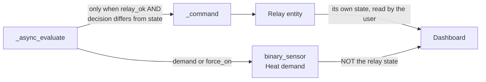
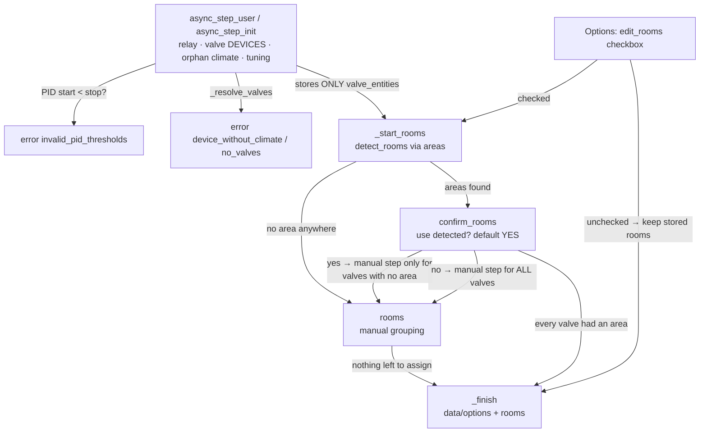
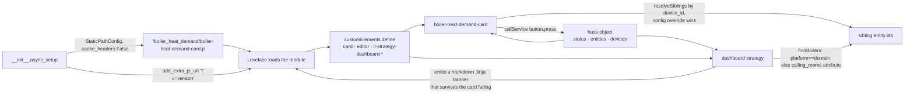

# Architecture — the components of `boiler_heat_demand` and how data moves between them

What this integration is made of, which surface each module owns, and which way
data flows across every edge — from a thermostatic radiator valve's `climate`
state to a relay service call, and back.

*Diagram current as of `651ead3` — 2026-11-20.* Kept up to date by the
"Architecture diagram upkeep — HA boiler demand" routine, which re-checks this
file against the commits made since that baseline whenever work happens in the
project.

Derived entirely from this repository: `custom_components/boiler_heat_demand/`,
`tests/`, `.github/workflows/validate.yml`, `README.md`, `AGENTS.md` and
`CONTRIBUTING.md` at commit `651ead3` ("Keep the minimum on/off lockout across
reloads and restarts"; `manifest.json` version `0.6.0`, unchanged since the
`c30b59a` release). **No live Home Assistant, boiler, relay or valve was
touched.** Every edge below is marked `measured-by-test`, `observed-only` or
`inferred` in §8, and the places that were never probed are named there rather
than drawn as if they had been.

**Ten Python modules plus one browser module, one config entry per relay, one
Home Assistant device ("Automated Boiler"), eleven entities, zero runtime
dependencies** (`manifest.json` `"requirements": []`). The control
loop is a single `async` evaluation, serialised behind a lock, that reads the
Home Assistant state machine and writes exactly one thing: a `turn_on` /
`turn_off` service call on a relay entity.

---

## 1. The whole system

```
  OUTSIDE THIS INTEGRATION — each line below is a Home Assistant entity or service
  ┌──────────────────────────────────────────────────────────────────────────┐
  │  TRV integration (Zigbee2MQTT / ZHA / Z-Wave / Matter / anything)        │
  │      climate.*   hvac_mode · hvac_action · current/target temperature    │
  │      sensor.* %  the device's PID heating demand, if it has one          │
  │  Room sensor (optional)      sensor.*, device_class temperature          │
  │  Outdoor sensor (optional)   sensor.* or weather.*                       │
  │  Relay                       switch.*  or  input_boolean.*               │
  │  notify.<service> (optional) critical-alert delivery                     │
  │  GAS BOILER                  behind the contact — NEVER read, NEVER      │
  │                              addressed. The loop ends at the relay.      │
  └─────┬──────────────────────────────────────┴─────────────────┴───────────┘
        │ states                               ▲ turn_on/off     ▲ notify
        ▼                                      │                 │
  ┌─────┬──────────────────────────────────────┴─────────────────┴───────────┐
  │  HOME ASSISTANT CORE                                                     │
  │  state machine + state_change events · entity/device/area registries     │
  │  Store  .storage/boiler_heat_demand.<entry_id>.learning                  │
  │  persistent_notification · issue_registry (Repairs) · http · frontend    │
  └─────┬──────────────────────────────────────┴─────────────────┴───────────┘
        │ tracked state changes +              ▲ service call,   ▲ alert
        │ a 30 s tick                          │ store, issues   │
        ▼                                      │                 │
  ┌─────┬──────────────────────────────────────┴─────────────────┴───────────┐
  │  controller.py — BoilerController            ONE PER CONFIG ENTRY        │
  │  the ONLY component that reads HA state and writes the relay             │
  │                                                                          │
  │  start() ──┬─ async_track_state_change_event  (entity list FIXED here)   │
  │            ├─ async_track_time_interval 30 s                             │
  │            └─ async_at_started  (defers the first run at boot)           │
  │                                                                          │
  │  async_evaluate() ─ asyncio.Lock ─ _guarded_evaluate()  catches ALL      │
  │         │                                                                │
  │         ├──▶ demand.py    PURE, no HA imports                            │
  │         │      _snapshot ▸ aggregate_room ▸ demand_met ▸ decide          │
  │         ├──▶ learning.py  PURE, no HA imports                            │
  │         │      observe() ▸ learned_call()  — refines, never overrides    │
  │         ├──▶ devices.py   pid_entity_for_climate, EVERY cycle            │
  │         │                                                                │
  │         ├─ _command()      ──▶ relay service call                        │
  │         ├─ _check_relay()  ──▶ relay_unavailable / relay_stuck alerts    │
  │         ├─ _raise_alert()  ──▶ notification + Repairs + notify.<service> │
  │         ├─ Store.async_delay_save  300 s models / 1 s last command       │
  │         └─ _publish()      ──▶ listener callbacks                        │
  └─────┬────────────────────────────────────────────────────────────────────┘
        │ down: add_listener ▸ async_write_ha_state
        ▼ up:   the four buttons call back into the controller
  ┌─────┬────────────────────────────────────────────────────────────────────┐
  │  binary_sensor.py (1)   sensor.py (6)              button.py (4)         │
  │  Heat demand            Rooms calling for heat     Boiler on             │
  │                         Rooms learned              Boiler off            │
  │                         Max room temp deficit      Resume automatic      │
  │                         Maximum PID demand         Reset learning        │
  │                         Cumulative PID demand                            │
  │                         Cumulative temp delta                            │
  │  all 11 under ONE device: 'Automated Boiler'  (DOMAIN, entry_id)         │
  └─────┬────────────────────────────────────────────────────────────────────┘
        │ down: states over the HA websocket
        ▼ up:   hass.callService('button', 'press') — the only write
  ┌─────┬────────────────────────────────────────────────────────────────────┐
  │  frontend/boiler-heat-demand-card.js  — runs in the BROWSER              │
  │  boiler-heat-demand-card + its editor                                    │
  │  ll-strategy-dashboard-boiler-heat-demand  (dashboard strategy)          │
  │  served at /boiler_heat_demand/...js?v=<version>, once per HA START      │
  └──────────────────────────────────────────────────────────────────────────┘

  setup / options path, not part of the loop:
      config_flow.py ──▶ devices.py ──▶ entity/device/area registries
      valve DEVICES ▸ climate entities ▸ areas ▸ rooms; stored only as
      valve_entities, so every earlier config entry still loads unchanged
```

Same graph in Mermaid, with every direction made explicit:

```mermaid
graph TB
    subgraph external["Outside the integration"]
        TRV["TRV integration<br/>climate.* entities"]
        PIDS["Per-device PID sensor<br/>sensor.*, unit %"]
        ROOMS["Optional room sensor<br/>sensor.*, device_class temperature"]
        OUT["Optional outdoor sensor<br/>sensor.* or weather.*"]
        RELAY["Relay entity<br/>switch.* or input_boolean.*"]
        NOTIFY["notify.* service"]
        BOILER["GAS BOILER<br/>never read, never addressed"]
        HACS["HACS / Marketplace<br/>install + update"]
        CI["GitHub Actions<br/>validate.yml"]
    end

    subgraph core["Home Assistant core"]
        SM["State machine<br/>+ state_change events"]
        REG["entity / device / area registries"]
        STORE["Store<br/>.storage/boiler_heat_demand.&lt;entry&gt;.learning"]
        PN["persistent_notification"]
        IR["issue_registry (Repairs)"]
        HTTP["http static path<br/>+ frontend extra_js_url"]
    end

    subgraph integ["custom_components/boiler_heat_demand"]
        INIT["__init__.py<br/>setup / unload / remove<br/>card route, device_info"]
        FLOW["config_flow.py<br/>config + options flow"]
        DEV["devices.py<br/>registry glue"]
        CTRL["controller.py<br/>BoilerController — the loop"]
        DEMAND["demand.py<br/>PURE decision logic"]
        LEARN["learning.py<br/>PURE thermal learner"]
        CONST["const.py<br/>keys + defaults"]
        ENT["binary_sensor.py · sensor.py · button.py<br/>11 entities, one device"]
    end

    CARD["frontend/boiler-heat-demand-card.js<br/>card + editor + dashboard strategy<br/>runs in the browser"]

    TRV --> SM
    PIDS --> SM
    ROOMS --> SM
    OUT --> SM
    RELAY --> SM
    SM -->|"states + tracked state_change events"| CTRL
    CTRL -->|"switch.turn_on/off or<br/>homeassistant.turn_on/off"| RELAY
    RELAY -.->|"dry contact — outside HA,<br/>never confirmed back"| BOILER
    CTRL -->|"calls on alert, fire-and-forget"| NOTIFY
    CTRL -->|"async_delay_save 300 s / 1 s"| STORE
    STORE -->|"async_load at setup:<br/>models + last relay command"| CTRL
    CTRL --> PN
    CTRL --> IR
    CTRL -->|"snapshots, aggregates, decides"| DEMAND
    DEMAND --> CTRL
    CTRL -->|"observe / learned_call"| LEARN
    LEARN --> CTRL
    CONST --> CTRL
    CONST --> FLOW
    CTRL -->|"_publish → listener callbacks"| ENT
    ENT -->|"async_write_ha_state"| SM
    ENT -->|"button.press → async_set_manual_override<br/>async_resume_automatic, async_reset_learning"| CTRL
    INIT -->|"creates, async_load, start/stop"| CTRL
    INIT -->|"registers card once per HA start"| HTTP
    INIT -->|"DeviceInfo 'Automated Boiler'"| ENT
    FLOW -->|"valve devices → climate entities<br/>areas → rooms"| DEV
    DEV --> REG
    FLOW -->|"entry.data / entry.options"| INIT
    CTRL -->|"pid_entity_for_climate, every cycle"| DEV
    HTTP -->|"/boiler_heat_demand/...js?v=version"| CARD
    SM -->|"hass.states / entities / devices<br/>over the websocket"| CARD
    CARD -->|"callService button.press"| SM
    HACS -->|"installs / updates the whole folder"| integ
    CI -->|"ruff, pytest, compileall, hassfest, HACS"| integ
```



---

## 2. Module → responsibility, and the explicit negatives

| module | owns | depends on HA? |
|---|---|---|
| `demand.py` | **all decision logic**: temperature/percentage parsing, staleness, valve→room aggregation, demand modes, min on/off and manual/safety arbitration (`decide`), area grouping, PID source scoring | **no** — zero HA imports, by design |
| `learning.py` | the per-room thermal model (`RoomModel`), its observation state machine (`RoomLearner`), and `learned_call`'s early-stop / pre-start refinement | **no** |
| `controller.py` | the only component that **reads HA state and writes a relay**. Subscriptions, the 30 s tick, per-valve snapshots, learner feeding, relay command + verification, alerts, persistence, publishing to entities | yes |
| `devices.py` | registry glue only: device→`climate`, `climate`→device, device→PID `sensor`, entity/device→area | yes |
| `config_flow.py` | setup and options: relay pick, valve **devices** (+ orphan climate entities), all tuning numbers, and the room-confirmation steps | yes |
| `__init__.py` | entry lifecycle, the `Automated Boiler` `DeviceInfo`, the card's static route and `extra_js_url`, and relay-off on **deletion** | yes |
| `binary_sensor.py` / `sensor.py` / `button.py` | 11 entities. Pure views over `BoilerController` attributes plus four command buttons | yes |
| `const.py` | config keys, defaults, `STORAGE_VERSION`, `SAVE_DELAY_S`, `RELAY_VERIFY_SECONDS`, `PLATFORMS` | no |
| `frontend/…card.js` | the Lovelace card, its editor, and the dashboard strategy. Plain web components, no build step, **no privileged access** — it is an ordinary frontend client | browser only |

**What is *not* part of this system.** The boiler's own controls, the relay
hardware, the TRVs and their PID algorithms, the integrations that publish those
entities, the room and outdoor sensors, and the `notify` platform. This
integration owns **one** piece of state in the world: the commanded on/off of a
relay entity. It computes a request for heat; it does not modulate, it does not
sequence a pump, it does not implement DHW priority, and it has no concept of
flow temperature. Boiler safety stays with the boiler (`README.md`,
`manifest.json` `iot_class: calculated`).

**What survives a component being removed.**

- Remove `learning.py` (or set *Self-learning* off): demand still works from the
  fixed rules. Learning is strictly a refinement layer on top of `base_calling`.
- Remove the card file: `async_setup` raises the `card_file_missing` Repairs
  issue and **returns `True` anyway** — boiler control is untouched. The YAML
  fallback in `README.md` reproduces the information with built-in cards.
- Remove the dashboard strategy: the card still works standalone; remove the
  card too and the eleven entities are still usable from built-in cards.
- Remove `controller.py`: nothing is left. It is the only writer.
- Remove the relay entity (it goes `unavailable`): the loop keeps evaluating,
  publishes demand, and after `relay_timeout_minutes` raises `relay_unavailable`
  — but it can no longer influence the boiler at all.

---

## 3. The load-bearing path — valve state to relay

This is the chain the installation depends on. It runs end to end on **every**
tracked state change and every 30 s, for every configured room.

```mermaid
graph LR
    A["climate.* state<br/>hvac_mode, hvac_action,<br/>current_temperature, temperature"] -->|"gate 1: available?<br/>not unavailable/unknown"| B["_snapshot"]
    B -->|"gate 2: valve_report_is_stale<br/>last_reported vs valve_timeout"| C["ValveState"]
    C -->|"gate 3: parse_temperature<br/>finite, -50..60 C, unit converted"| D["aggregate_room"]
    ROOMSENSOR["Room sensor<br/>(optional)"] -->|"gate 3b: valid AND fresh<br/>within max(valve_timeout, 2 h)"| D
    D -->|"temp = sensor else MEDIAN of active valves<br/>target = MAX of active valves"| E["RoomState"]
    E -->|"gate 4: available? active?"| F["base demand<br/>hvac_action or hysteresis"]
    F -->|"gate 5: learned_call<br/>only if model.ready (3 cycles)"| G["calling rooms"]
    G -->|"gate 6: demand_met<br/>mode-specific hysteresis"| H["demand: bool"]
    H -->|"gate 7: decide<br/>min_on / min_off lockout"| I["Decision.boiler_on"]
    SAFE["Low-temperature safety<br/>force_on"] -->|"bypasses min_off,<br/>beats manual OFF"| I
    MANUAL["Manual override<br/>in memory only"] -->|"bypasses BOTH lockouts"| I
    I -->|"only if it differs from<br/>the relay's current state"| J["_command"]
    J -->|"switch.turn_on/off if id starts 'switch.',<br/>else homeassistant.turn_on/off"| K["Relay entity"]
    K -.->|"NOT OBSERVED"| L["Gas boiler"]
    K -->|"state read back next cycle"| M["_check_relay<br/>60 s verify window"]
```



Six properties of this chain decide whether an installation behaves:

1. **The loop closes on the relay *entity*, not on the boiler.** `_check_relay`
   compares what was commanded against what the relay entity reports. A relay
   that answers `on` while its contact is welded, or a boiler that ignores a
   closed contact, is **invisible to every alert in this integration**. There is
   no flow-temperature, flame or current feedback anywhere in the design.
2. **The subscription set is a snapshot taken in `start()`; demand is recomputed
   every cycle.** `start()` subscribes to the valves, the relay, the configured
   room sensors, and the PID sensors *resolvable at that moment*. But
   `_async_evaluate` re-resolves `pid_entity_for_climate` for every valve on
   every cycle. So a PID sensor that appears later (firmware update, re-pair) is
   **used** by the demand logic but is **not a wake source** until the entry is
   reloaded — its value only lands on the next 30 s tick.
3. **The outdoor sensor is read but never subscribed.** It is not in `start()`'s
   entity list at all; `_outdoor_temp` is called inside `_async_evaluate`. It
   also skips the staleness check (`_sensor_temp` is called without `now`), so a
   frozen outdoor reading is used indefinitely for cooling-rate prediction.
4. **"No valve state at all" is not "no demand".** If every configured valve has
   no state object, `_async_evaluate` returns *before* touching the relay and
   before arming any lockout. That is what stops a Home Assistant restart from
   switching a running boiler off while entities are still loading.
5. **PID mode degrades silently to valve count.** `demand_met` falls back to
   `calling_count >= min_valves` whenever no active valve yields a valid value.
   No alert, no attribute flag — the only hint is `pid_source_by_valve` on
   *Maximum PID demand* going empty.
6. **Three sources race for each valve's PID value, in a fixed order** — a
   legacy `pid_demand_attribute` from an old config entry, then the device's PID
   `sensor`, then an auto-detected climate attribute. The first that parses to a
   number in `[0, 100]` wins, per valve, per cycle. Valves can therefore switch
   source between cycles.

### Direction asymmetries — where the obvious mental model is wrong

**`Heat demand` is not the relay.** The binary sensor publishes
`Decision.demand`, which is `demand or force_on`. When the relay is
*unavailable*, the controller publishes `Decision(demand or too_cold, False, …)`
and returns — so demand can read `on` while nothing was commanded, and
`boiler_on` reads `False` while the relay may well be stuck on. **No entity in
this integration reports the relay's actual state**; that is the relay entity's
own job.



**`pid_source_by_valve` over-reports.** In `_async_evaluate` the source is
recorded for every available valve with a parsed value, but the value is only
appended to `pid_demands` when `hvac_mode not in (None, "off")`. A valve switched
off therefore appears in `pid_source_by_valve` while contributing nothing to
*Maximum PID demand* or *Cumulative PID demand*.

**Learning is keyed by room *name*.** `self.learners[name]`, persisted under
`rooms` in the store. The name is the configured room name, or — for a valve with
no room — **the valve's entity id**. Renaming an area and re-detecting rooms, or
renaming a `climate` entity, creates a new key: the old model is orphaned in the
store and the room starts from zero cycles. Nothing reports this.

**The store carries two unrelated things with different urgencies.** Learned
models are debounced by `SAVE_DELAY_S = 300`; the relay's last command is saved
with a 1 s delay so a reload right after a switch still sees it. `Reset learning`
calls `async_remove()` on the whole store and then re-saves only the relay
record — deliberately keeping the lockout while dropping every model. But it
re-saves that record **only if `_last_command` is set**, and `_last_command` is
populated by `_command`, never by `async_load`. Pressing *Reset learning* after a
restart but before this controller has switched the relay therefore deletes the
persisted lockout outright: the running controller still honours the lockout it
restored into `_last_change`, and the next reload starts with none.

**The lockout is stored in wall-clock time and restored into monotonic time.**
`_command` records `dt_util.utcnow().timestamp()`; the restore turns it into an
age and backdates `time.monotonic()`. The age is clamped at `0`, so a system
clock that stepped *backwards* during the downtime re-arms the full lockout,
while one that stepped forwards shortens or cancels it. The restore is also a
one-shot, and it sits **after** both early returns — so it survives cycles where
no valve has loaded yet or the relay is unavailable, but the first cycle that
does reach it consumes `_restored_change` and arms nothing at all if the relay no
longer reports the state that was commanded.

**Removal and reload are not the same operation.** `async_unload_entry` stops
the controller and leaves the relay exactly as it is; `async_remove_entry` turns
an **on** relay off, because nothing will manage it afterwards. An options change
is a reload, so it never touches the relay.

**Card registration is per Home Assistant *start*, not per entry setup.** The
static route lives in `async_setup`, because registering the same path twice
raises and `async_setup_entry` runs again on every reload. The route stays at the
bare URL; only the URL handed to `add_extra_js_url` carries `?v=<version>`. A
reload therefore never updates the card a browser has cached.

---

## 4. Per-component data flow

### 4.1 `controller.py` — `BoilerController`

The whole control loop, and the only writer.

| | |
|---|---|
| **In** | `hass.states` for valves, relay, room sensors, PID sensors, outdoor sensor; `entry.data` merged under `entry.options` (`_cfg`); the store (`rooms`, `last_command`); button presses via three `async_*` methods |
| **Out** | `switch.turn_on/off` or `homeassistant.turn_on/off` on the relay; `notify.<service>`; `persistent_notification`; `issue_registry` issues; `Store.async_delay_save`; listener callbacks to the eleven entities |
| **Wake sources** | `async_track_state_change_event` over a **fixed** entity list, `async_track_time_interval(30 s)`, `async_at_started` at boot, and each button press |
| **Concurrency** | one `asyncio.Lock`; every evaluation runs as an `entry.async_create_background_task`, cancelled on unload; `_stopped` blocks both a late evaluation and a late `_command` |
| **Failure containment** | `_guarded_evaluate` catches **everything** and raises the critical `evaluation_failed` alert, cleared on the next good run. `_publish` wraps each listener so one broken entity cannot block the others |

Five alert keys exist. Four are per-entry and appear in the *Heat demand*
`alerts` attribute: `relay_unavailable`, `relay_stuck`, `relay_command_failed`,
`evaluation_failed`. The fifth, `card_file_missing`, is raised in `__init__.py`
at the **integration** level and is **not** in that attribute — a dashboard
reading only `alerts` will never show it.

Retry is implicit, not scheduled: `_command` runs whenever the decision differs
from the relay's state, so a failed switch is re-sent on the next cycle, while
`_mark_commanded` keeps the original timestamp so `RELAY_VERIFY_SECONDS = 60`
measures from the *first* attempt.

### 4.2 `demand.py` — the pure core

| | |
|---|---|
| **In** | plain values only: `ValveState` dataclasses, floats, mappings, `datetime`s |
| **Out** | `RoomState`, `Decision`, booleans, parsed floats, `RoomConfig` lists, a chosen PID entity id |
| **Interface** | ordinary Python calls. No HA imports, so it is unit-tested directly (`tests/test_demand.py`, 40 tests) |

The arbitration order in `decide` is worth stating exactly, because three
mechanisms can disagree: `demand = demand or force_on`; `target = manual_override
if set else demand`; then `force_on` forces `True` regardless; then the min on/off
lockout applies **only when `manual_override is None`** and not when `force_on`
is driving on. So: **frost protection > manual > lockout > computed demand.**

`parse_temperature` is the single funnel for every temperature in the system —
finite, boolean-rejecting, `°F`/`K` converted, unknown units rejected, and
clamped to −50…60 °C. A hostile or faulty sensor cannot disable frost protection
by reporting `nan`; it falls back to the valves.

### 4.3 `learning.py` — the per-room learner

| | |
|---|---|
| **In** | one `observe(now, temp, target, heating, outdoor, start_deficit)` per room per cycle. `heating` is `boiler_is_on AND room.calling` |
| **Out** | a mutated `RoomModel`; `learned_call` returns a refined boolean; `anticipation` the early-stop margin |
| **Persistence** | `RoomModel.to_dict` / `from_dict`. **Every** stored field is re-validated and clamped on load, and a non-`int` `cycles` is dropped |
| **Gates** | rate samples need a 15 min–2 h window; `ready` needs 3 complete coast cycles **and** a non-`None` `heat_rate`; a coast rise or overshoot above 10 °C is discarded as a sensor glitch, not learned |

`learned_call` is a refinement, never an override of safety: it only changes
`base_calling`, and everything in §3 gate 6–7 still runs on top.

### 4.4 `devices.py` — registry glue

| | |
|---|---|
| **In** | `entity_registry`, `device_registry`, `area_registry` |
| **Out** | device→`climate` entity ids, `climate`→device ids, device→PID `sensor` id, valve→`(area_id, area name)` |
| **Used by** | `config_flow.py` at setup/options time, and `controller.py` on **every cycle** for `pid_entity_for_climate` |

The area rule is a precedence, not a union: the entity's own area wins over its
device's area. The PID sensor is scored by `demand.find_pid_entity` against
`translation_key`, `name`, the entity-id suffix and `unique_id`, and anything
measured in a unit other than `%` (or no unit) is rejected outright — which is
what makes a renamed entity id keep working.

### 4.5 `config_flow.py` — setup and options



| | |
|---|---|
| **In** | user input; the registries via `devices.py`; the existing entry (`{**data, **options}`) |
| **Out** | `entry.data` on create, `entry.options` on update — both merged by the controller, options winning |
| **Stored valve format** | **always `valve_entities` (climate entity ids)**. `valve_devices` is a *form* field only: it is resolved and `pop`ped, never persisted. That is what lets config entries from every earlier version load unchanged, and why the options form re-derives its device pre-selection from the stored entity ids |
| **Uniqueness** | `async_set_unique_id(relay_entity)` — one config entry per relay |
| **Re-entry** | any options save triggers `_reload`, which fully reloads the entry: new controller, learners **and the relay lockout** re-read from the store, **in-memory manual override and relay verify window discarded** |

### 4.6 The entity layer — `binary_sensor.py`, `sensor.py`, `button.py`

Eleven entities, all under one `DeviceInfo` identified by
`(DOMAIN, entry.entry_id)` and named **Automated Boiler**. Unique ids are
`f"{entry.entry_id}_{suffix}"` and are a stability contract (`AGENTS.md`).

| entity | reads from the controller | notes |
|---|---|---|
| `binary_sensor` **Heat demand** | `decision.demand`, `decision.calling`, `max_deficit`, `safety_override`, `manual_override`, `manual_override_seconds_left`, `alerts` | the card's and strategy's anchor entity |
| `sensor` **Rooms calling for heat** | `len(decision.calling)` | |
| `sensor` **Rooms learned** (diagnostic) | count of ready models + full per-room model as attributes | the only window into `learning.py` |
| `sensor` **Maximum room temperature deficit** (diagnostic) | `max_deficit`; attributes `demand_mode`, `effective_temperature_deficit`, `start_deficit`, `stop_deficit`, `manual_override` | raw `target − current`, not learning-adjusted |
| `sensor` **Maximum PID demand** | `max_pid_demand`; attribute `pid_source_by_valve` | pre-existing identity; must stay intact |
| `sensor` **Cumulative PID demand** | `cumulative_pid_demand` | live **sum**, can exceed 100 %; not a time integral |
| `sensor` **Cumulative temperature delta** | `cumulative_temp_delta` | live sum of `max(0, target − current)`; not a time integral |
| 4 × `button` | `async_set_manual_override(True/False)`, `async_resume_automatic()`, `async_reset_learning()` | the **only write surface** into the controller |

Every entity is `should_poll = False` and refreshed by `_publish`. They are pure
views: the attributes are read at render time from live controller fields, so two
entities can never disagree about a cycle.

### 4.7 `frontend/boiler-heat-demand-card.js` — card and dashboard strategy



| | |
|---|---|
| **In** | only the `hass` object it is handed — `hass.states`, `hass.entities`, `hass.devices`. It never calls the integration directly and has no privileged channel |
| **Out** | DOM, and exactly one write: `hass.callService("button", "press", …)` |
| **Entity discovery** | `resolveSiblings` matches by `device_id` + slug/friendly-name suffix, shared by the card and the strategy so both resolve identically. Explicit card config always wins |
| **Degradation** | `setConfig` never throws (a bad config renders a hint); the strategy's `generate` never throws (it returns a markdown error view); a missing button entity hides just that button; the strategy's plain-markdown status banner keeps alerts and the frost-protection state readable **even if the custom card fails to load** |
| **Tested by** | `tests/test_frontend.py` (route + stamp + `card_file_missing`) and `tests/test_status_banner.py`, which drives the real shipped strategy through `node` and renders its Jinja through Home Assistant's own template engine — specifically so the template cannot drift from a copy in a test |

Two deliberate shapes: *Reset learning* is kept out of **Details** and placed in
its own **Maintenance** section behind a confirmation dialog, and the strategy
does **not** appear in HA's *Add dashboard* picker — there is no registry through
which a custom strategy can advertise itself, so the user pastes two lines of
YAML once.

---

## 5. Change exposure — what moves with nobody acting

| what can change unattended | blast radius | rollback |
|---|---|---|
| **A TRV integration update** renames, re-units or removes the per-device PID sensor, or renames a climate attribute | the PID source is re-resolved **every cycle**, so demand can change source or lose it mid-operation and silently fall back to valve count | none in this integration; re-detection is automatic in both directions |
| **A Home Assistant core upgrade.** `manifest.json` declares `"requirements": []` and only `http` + `frontend` dependencies; `hacs.json` pins a **minimum** `2024.12.0` and no maximum | every HA API used is unpinned: `last_reported`, selector configs, `er.async_entries_for_device`, `add_extra_js_url`, `StaticPathConfig`, the Lovelace strategy contract, `async_create_background_task` | HA snapshot only |
| **A HACS / Marketplace auto-update of this integration** | replaces the whole folder, card file included. Until HA is **restarted** the card route is not re-registered, and until the browser refetches, **a live browser can run a card from a different version than the backend** | reinstall the previous release |
| **An HA area rename or reassignment** | nothing, until someone ticks *Re-detect rooms*. Stored `rooms` is a snapshot. When it is re-run, renamed rooms get new learner keys and **start learning from zero** | none — the old models are orphaned, not restored |
| **A `climate` entity-id rename** for a valve with no room | same: that valve's room key changes, its model is orphaned | none |
| **Dependabot** bumps the SHA-pinned CI actions and `pytest-homeassistant-custom-component==0.13.375` | CI only; actions are SHA-pinned and the HA test dep is version-pinned, deliberately **not** a runtime requirement | revert the PR |
| **A valve or sensor simply going quiet** | after `valve_timeout_minutes` it is treated as unavailable; a whole room unresponsive follows the configured failsafe (`ignore` / `call_for_heat` / `hold_last`) | n/a — this is designed behaviour |

**No rollback at all** for three things, worth knowing before touching them:

- **`Reset learning`** calls `Store.async_remove()`. Every room's model is gone
  immediately; the relay lockout record is rewritten only if this controller has
  commanded the relay since it loaded (§3). There is no backup.
- **Deleting the config entry** turns an `on` relay **off** as a side effect of
  removal.
- **Learning written up to 5 minutes late.** `SAVE_DELAY_S = 300`, so an abrupt
  Home Assistant kill loses up to five minutes of learning progress — bounded
  and harmless, but it means "the model updated" and "the model is on disk" are
  not the same claim.

---

## 6. Restart, reload and config change — the three resets that are not alike

The task these diagrams exist for: knowing what is kept and what is dropped.

| state | Home Assistant restart | entry reload (options save) | entry delete |
|---|---|---|---|
| learned `RoomModel`s | **kept** (store, validated and clamped on load) | kept | **deleted with the store** |
| min on/off lockout (`_last_change`) | **kept** since `651ead3`, re-armed from the stored `last_command` — if all three conditions below hold | **kept**, same three conditions | n/a |
| manual override + its timer | **lost**, returns to automatic | **lost** | n/a |
| alerts (`self.alerts`) | **lost**; re-raised on the next bad cycle. Repairs issues and notifications were created in HA and persist | lost, same | Repairs issues outlive the controller unless cleared |
| `_commanded` / verify window | lost | lost | n/a |
| relay | untouched; `async_at_started` defers the first evaluation, and "no valve state at all" returns before switching | untouched | **turned off if on** |
| the card's static route | re-registered once in `async_setup` | **not** re-registered | route stays until restart |

Row 2 is what changed at `651ead3`, and it is a conditional "kept", not an
unconditional one. All three must hold for the lockout to carry over:

1. **The store holds a `last_command`.** It is written by `_command` with a 1 s
   debounce, so only if *this integration* has actually switched the relay since
   the store was last removed. A fresh install, or a *Reset learning* before the
   first switch, leaves no record.
2. **The record passes `async_load`'s validation** — a two-element list of a real
   `bool` and a finite, non-`bool` number. Anything else is ignored in silence
   and the entry starts with no lockout.
3. **The relay still reports the state that was commanded** (`was_on ==
   boiler_is_on`), tested on the first cycle that reaches the lockout code.

When all three hold, `_last_change` is backdated by the record's age, so the
minimum on/off time expires at the wall-clock moment it would have anyway — that
is what stops a tight reload loop from short-cycling the boiler. When any one
fails, the first evaluation sees `seconds_since_change is None`, which `decide`
reads as "no lockout applies", and the boiler may switch immediately.
`tests/test_ha_glue.py` holds both halves: `min_on_lockout_survives_a_reload`
for the carry-over,
`persisted_lockout_is_ignored_when_the_relay_changed_meanwhile` for condition 3,
and `restart_with_running_relay_and_missing_valves_does_not_switch_it_off` still
asserts `_last_change is None` on a cold start with no stored record.

**What is still not carried over is the verify window.** `_commanded` and
`_commanded_at` are in memory only (row 5). A command issued seconds before a
reload is therefore never checked against the relay by the new controller: the
lockout remembers that a switch happened, but nothing remembers that it was
unconfirmed, so a `relay_stuck` that was about to fire is quietly forgotten.

---

## 7. Failure attribution

Read the symptom, suspect the right component. Several rows are **not faults.**

| symptom | suspect | why |
|---|---|---|
| `Heat demand` is `on` but the radiators are cold | **not this integration** — the relay or the boiler | the loop closes on the relay entity; it has no feedback from the boiler. Check the relay entity's own state and the boiler |
| `Heat demand` is `on` while the relay is `off` | **relay unavailable** path | when the relay is unavailable the controller publishes `demand` with `boiler_on=False` and returns. Look for `relay_unavailable` |
| Repairs: *relay not following commands* | the relay entity or its integration | `_check_relay`: commanded ≠ reported for more than 60 s |
| Repairs: *relay unavailable* | the relay entity or its integration | unavailable for longer than `relay_timeout_minutes` (default 5) |
| Repairs: *Boiler control stopped* (`evaluation_failed`) | **`controller.py`** — a real bug | the only alert that means the integration itself failed. Relay keeps its last state. HA log has the traceback |
| *Maximum PID demand* is empty and demand looks like valve counting | **not a fault** — the PID fallback | no active valve yielded a value in `[0, 100]`; `demand_met` fell back to `calling_count >= min_valves`. Check `pid_source_by_valve` |
| A valve appears in `pid_source_by_valve` but never moves the maximum | **not a fault** | the source is recorded before the `hvac_mode != off` filter; an off valve contributes nothing |
| A room's `Rooms learned` entry reset to 0 cycles | **not a fault** — a key change | the room name or the valve's entity id changed; learners are keyed by room name |
| Learning never becomes `ready` | `learning.py` gates, or a coarse sensor | needs 3 complete coast cycles **and** a `heat_rate`, which needs a 15 min–2 h window with ≥ 0.05 °C/h rise. 0.5 °C-resolution sensors learn slowly |
| Boiler short-cycles right after a restart or a reload | **a missing or rejected `last_command` record** | the lockout is re-armed from the store, but only under the three conditions in §6 — most often the relay no longer reports the commanded state, or this integration had never switched it |
| The lockout survived reloads, then stopped after a *Reset learning* | **not a fault** — a documented trap | `async_remove()` drops the whole store and rewrites the relay record only if this controller had commanded the relay since loading; see §3 |
| A relay that did not follow a command raises no `relay_stuck` after a reload | **by design, and a real gap** | the verify window is in memory only; §6 |
| An outdoor-temperature change does nothing for up to 30 s | **not a fault** — by design | the outdoor sensor is read inside the evaluation and is **not** subscribed |
| A new PID sensor is ignored until a reload | **partly by design** | it is used by the demand logic from the next tick, but it is not a wake source until `start()` re-runs |
| `Custom element doesn't exist: boiler-heat-demand-card` | the browser cache, or `card_file_missing` | the route is registered once per HA **start**; a reload is not enough. Check the log line and Repairs. Boiler control is unaffected |
| The card shows the old layout after an update | **browser cache** | only the `?v=` URL changes, and only at HA start |
| A manual On/Off silently stopped after two hours | **not a fault** | `manual_override_minutes` default 120; `0` disables expiry |
| Manual OFF, but the boiler is heating | **not a fault** — frost protection | `force_on` beats a manual OFF by design; the card shows the *Low-temperature safety active* banner |
| Changing a valve's HA area did nothing | **not a fault** | stored `rooms` is a snapshot; tick *Re-detect rooms* in options |
| `Cumulative PID demand` over 100 % | **not a fault** | it is a live sum across active valves, not a percentage of anything and not a time integral |

---

## 8. Confidence — what was measured, what was only read

This document was produced **read-only from the repository**. "Measured" here
means *exercised by a test in this repo that actually runs in CI* — not probed on
live hardware. No live Home Assistant, relay, boiler or valve was contacted.

| edge | status |
|---|---|
| `demand.py` decision logic: parsing, staleness, aggregation, all three demand modes, `decide` arbitration, area grouping, PID scoring | ✅ **measured-by-test** — `tests/test_demand.py`, 40 tests, pure functions |
| `learning.py` model, clamping on load, coast/overshoot gates | ✅ **measured-by-test** — `tests/test_learning.py`, 9 tests |
| state machine → `_snapshot` → PID source resolution (device sensor, climate attribute, legacy entry) | ✅ **measured-by-test** — `tests/test_ha_glue.py` against real device/entity registries |
| `_command` → relay service call, and relay state read back | ✅ **measured-by-test** — PID-driven relay switching, failsafe, and "no evaluation commands the relay after `stop()`" |
| restart behaviour: deferred first evaluation, missing valves not switching a running relay off | ✅ **measured-by-test** |
| the restored relay lockout: carry-over under a frozen clock, and the rejection when the relay changed meanwhile | ✅ **measured-by-test** — the two §6 tests, both of which set `_restored_change` on the controller directly |
| the round trip that feeds it — `_command` → `_dump` → the `.storage` file → `async_load` → `_restored_change` | ⚪ **inferred** — no test writes and re-reads a `last_command`. The tolerant-loading test covers `RoomModel.from_dict`, not this record, so the validation in condition 2 of §6 is code-read only |
| frost protection with invalid / stale / offline sensors; unit conversion | ✅ **measured-by-test** |
| manual-override expiry and never-expire | ✅ **measured-by-test** |
| `evaluation_failed` raise/clear, and listener isolation in `_publish` | ✅ **measured-by-test** |
| tolerant store loading from corrupt data | ✅ **measured-by-test** |
| `async_remove_entry` turning a running relay off | ✅ **measured-by-test** |
| the eleven entities sharing one `Automated Boiler` device | ✅ **measured-by-test** |
| areas → room detection, and all three config-flow room branches | ✅ **measured-by-test** |
| card static route, the `?v=` stamp, and `card_file_missing` | ✅ **measured-by-test** — `tests/test_frontend.py` |
| the dashboard strategy's generated config and its Jinja status banner | ✅ **measured-by-test** — `tests/test_status_banner.py` drives the real module through `node`; skips if `node` is missing, and CI fails first if it is |
| the card's own rendering, editor, timer and `resolveSiblings` in a browser | 🟡 **observed-only** — only the strategy half of the JS is executed by CI. The card's DOM behaviour is code-read, never rendered in a test |
| `notify.<service>` delivery of a critical alert | ⚪ **inferred** — the call is fire-and-forget (`async_create_task`) and its failure is logged, not alerted. No test, no live send |
| relay entity → physical contact → **gas boiler** | ⚪ **out of reach by design** — the integration has no feedback path past the relay entity, and this routine is read-only with respect to live systems |
| behaviour against any specific TRV vendor (Zigbee2MQTT, ZHA, Z-Wave, Matter, Danfoss/Sonoff/Aqara attribute shapes) | ⚪ **inferred** — `PID_ATTRIBUTE_CANDIDATES` is a name list, not a measured compatibility matrix |
| reload/restart interaction with a live HA frontend and browser cache | ⚪ **inferred** — reasoned from `async_setup`, `add_extra_js_url` and `cache_headers=False`; never observed in a browser |
| config-flow behaviour against a large real installation (dozens of devices, mixed areas) | ⚪ **not probed** |

Three gaps are worth closing if this diagram is ever used for change planning:
the card's browser-side rendering has no automated coverage at all (the strategy
does); the `notify` path — the one that is supposed to wake a human when the
relay is stuck — is the least exercised edge in the system; and, newly at
`651ead3`, the relay lockout's *decision* side is tested while its *persistence*
side is not, so a change to `_dump` or `async_load` could break the carry-over
with every existing test still green.

---

## 9. Read next

- `README.md` — the user-facing contract: options table, entity list, PID source
  resolution, dashboard setup and the security/safety notes
- `AGENTS.md` — the behaviour and entity contract this diagram must not drift
  from, plus the validation commands
- `CONTRIBUTING.md` — dev environment, the two local commands, PR conventions
- `custom_components/boiler_heat_demand/demand.py` — read this before changing
  any decision; it is the whole state machine, in one file, with no HA imports
- `tests/test_ha_glue.py` — the honest statement of which §1 edges are actually
  held in place by a test
- `SECURITY.md` — reporting route; anything that can leave the relay stuck counts
